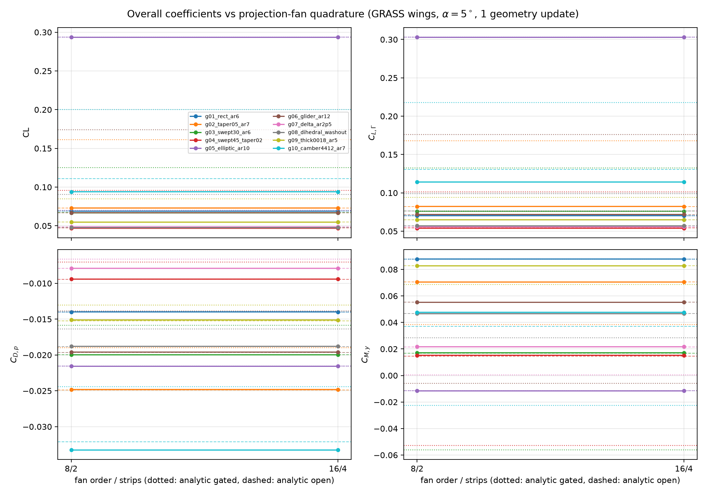
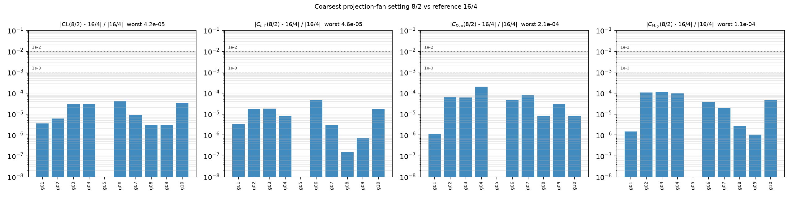

# 十种 GRASS 机翼上的 fan order/strips 系数收敛（issue #84 A 阶段附加研究）

## 1. 目的

用户要求（m26162）：用 GRASS-plane 的机翼创建逻辑创建 10 个几何，跑不同 projection-fan
order/strips，画出总体气动系数（CL、CL_gamma、CD_p、CM_y）的收敛图。

本项目里 fan 配置只通过一条链路影响总体系数：尾迹节点的诱导速度 -> 尾迹几何更新 ->
壁面势场与载荷。因此每个 (几何, 配置) 都必须至少做 1 次 geometry update，否则所有配置
读数完全相同（iterations=0 时与 fan 无关，见第 5 节）。

## 2. 几何集（GRASS CST 剖面 + DPanel 连接性）

十个几何由 tools/grass_fan_convergence/cases.py 定义：GRASS 的 CST 剖面代码
（cst_airfoil_codec.fit_airfoil_points / wing_geometry_encoder）给出每个展向站位的
上下表面点，tools/grass_fan_convergence/wing_builder.py::build_wing 按 DPanel
make_wing 的连接性（LE/TE 单共享顶点、内部 TE 复制下表面势 DOF、端帽质心扇形、
尾迹沿 +x 拉伸）装配成 full-span Wing。

每个几何 4 个展向站位 / span_panels=3 / chord_panels=8 / wake_panels=2：
608 壁面 / 72 尾迹面 / 17 个环量基函数 / 129 个尾迹采样点。

| 几何 | 剖面 | 平面形状 |
| --- | --- | --- |
| g01_rect_ar6 | NACA 0012 | 矩形，半展 3，弦 1（S_ref 6.000） |
| g02_taper05_ar7 | NACA 2412 | 1 -> 0.55 收缩（S_ref 5.250） |
| g03_swept30_ar6 | NACA 2412 | 前缘后掠 30°，1 -> 0.6（S_ref 4.800） |
| g04_swept45_taper02 | NACA 0012 | 后掠 45°，1 -> 0.2（S_ref 2.400） |
| g05_elliptic_ar10 | NACA 4412 | 椭圆平面形状，6 站位 / 992 面（S_ref 7.747，半展 4.96） |
| g06_glider_ar12 | NACA 63A210 | 高展弦比滑翔机，弦 0.70，半展 4（S_ref 4.000） |
| g07_delta_ar2p5 | NACA 0012 | 三角翼，50° 后掠，根弦 1.40（S_ref 2.400） |
| g08_dihedral_washout | NACA 2412 | 5° 上反 + -4° 几何扭转（S_ref 5.100） |
| g09_thick0018_ar5 | NACA 0018 | 18% 厚翼（S_ref 4.500） |
| g10_camber4412_ar7 | NACA 4412 | 4% 弯度（S_ref 5.950） |

S_ref 由脚本按平面形状积分写入 JSON 的 geometry 字段。

装配期的两处修正（都在 `wing_builder.py` / `cases.py` 里）：

1. 椭圆平面形状原本取 theta 到 pi/2，翼尖弦长恰好为 0（退化面元）——初始非线性解直接爆到
   1e12。现在截到 0.46*pi（翼尖弦长约为根弦的 12.5%）。
2. GRASS 的 CST 编解码器只接受固定的 100 点布局（50 上表面 TE->LE + 共享 LE + 49 下表面），
   而 naca63a210.dat 只有 52 点。新增 `dat_code()`：解析 Selig 文件、按余弦 x 网格重采样两侧
   表面、闭合尾缘偏移，再拟合 CST。

## 3. 求解设置

panel.p1_coupled_material_wake.solve_coupled_material_wake(mesh, 5.0, kutta="pressure",
iterations=1, order=48, core_radius=0.01, ...)；配置：

- analytic：未正则的解析边核 analytic_edges + 生产门控（epsilon_tol 0.02 / quadrature_tol 0.002）；
- analytic_open：同一核，但 epsilon/quadrature 容差置 1e3（所有尾迹节点都被接受）；
- 8:2/16:2、16:4/32:4：rm_regularized_p1 + projection_fan，base 与 refinement 成对出现
  （refinement order = 2x base order，strips 不变），门控比较 base 与 refinement；
- 8:2/16:2@open：同 fan 配置，但 epsilon/quadrature 容差置 1e3（门控打开），用于把
  「哪些节点被推进」与「fan 求积误差」分开。

## 4. 结果：三档 fan 设置下系数已经走平

表格与图由 tools/grass_fan_convergence/report.py 从
docs/issue84/grass_fan_convergence.json（+ \_open.json）生成：
docs/issue84/grass_fan_convergence_tables.md 与 docs/issue84/figures/ 下四张图
（fan_coefficients、fan_relative_deviation、fan_cost、fan_gate_effect）。

最粗档 8:2 相对最细档 16:4 的相对偏差（十几何的最大值）：

| 量 | 最坏相对偏差 | 对应几何 |
| --- | --- | --- |
| CL | 4.2e-5 | g06_glider_ar12 |
| CL_gamma | 4.6e-5 | g06_glider_ar12 |
| CD_p | 2.1e-4 | g04_swept45_taper02 |
| CM_y | 1.1e-4 | g03_swept30_ar6 |

即：把 fan order 从 8 提到 16、strips 从 2 提到 4，总体系数变化小于 1e-3（CL 上小两个数量级），
全部在工程收敛门（1e-2，图上第二根参考线）以内两个数量级以上。24:8/32:8 在 g01、g02 上做过
spot check（566 s/几何）：g02 的 CL 0.07296330 -> 0.07296328（2e-8），与 16:4 逐位同一量级，
确认 8:2 之后的差异是 fan 积分残差而不是还在收敛。

g05_elliptic_ar10 是唯一状态不是 iteration_limit 的几何（blocked_initial_nonlinear_solve，
见第 6 节），但它的四个配置读数逐位相同，因为尾迹几何更新没有落地，fan 配置无从体现——
这一行不能当作收敛证据。

成本（同一几何、同一次几何更新）：analytic 2-10 s、8:2/16:2 40-89 s、16:4/32:4 176-264 s；
成本几乎与 strips 无关、由 order 主导（order^2 量级，见 docs/ISSUE84_P0_PROFILE.md 的核占比）。

## 5. 机制：门控决定「哪些节点被推进」，fan order 只在 1% 量级

g02_taper05_ar7 上五个对照（同一网格、iterations=1）：

| 跑法 | 被接受节点 / 总数 | 被推进节点 | CL | CD_p | CM_y |
| --- | --- | --- | --- | --- | --- |
| analytic | 37 / 55 | 37 | +0.16099469 | -0.01901007 | +0.03829697 |
| analytic + tol=1e3 | 55 / 55 | 55 | +0.07280292 | -0.02489498 | +0.07054404 |
| fan 8:2/16:2（门控） | 54 / 55 | 54 | +0.07296285 | -0.02481770 | +0.07048712 |
| fan 8:2/16:2（tol=1e3） | 55 / 55 | 55 | +0.07296288 | -0.02481866 | +0.07049493 |

- 初始解（iterations=0）三者完全一致：CL=+0.16093316 —— 壁面解与 fan 无关。
- analytic 的 18 个 epsilon 拒绝让同一张尾迹片里部分节点被推进、部分冻结，尾迹形状被破坏，
  CL 因此差 2.2 倍。
- 一旦把 gate 打开，analytic 与 fan 的差只有 0.22%（0.07280292 vs 0.07296285），这就是 fan
  求积本身的效应。

g03_swept30_ar6 同构：analytic 0.12520203 -> analytic_open 0.06707786（1.87x），
fan 8:2 0.06673425 与 open 差 0.51%。

十个几何都做了同样的四跑（analytic / analytic_open / fan 8:2 门控 / fan 8:2 open），
完整表在 grass_fan_convergence_tables.md 的「Gate effect」一节与
docs/issue84/figures/fan_gate_effect.png：

- analytic 门控 CL / analytic open CL = 1.00x（g01，只拒 1/37、g05 未更新）、1.43x（g07）、
  1.55x（g09）、1.80x（g10）、1.87x（g03）、1.90x（g08）、2.03x（g04）、2.21x（g02）、
  2.61x（g06）；
- analytic 的 epsilon 拒绝数：g02 18/37、g03 19/37、g04 17/39、g05 33/58、g06 17/38、
  g07 19/37、g08 20/35、g09 19/36、g10 19/37；
- fan 8:2 在同一批几何上只拒 0-5 个、16:4 拒 0 个，**fan 门控 vs fan open 的比值在十个几何上
  全是 1.000x**（差异 <=3e-8）—— 也就是说 fan 路径上门控几乎不改变推进集合，反过来证明了
  analytic 的 2 倍差异纯粹来自「部分节点被冻结」。

结论：总体系数对 fan order/strips 不敏感（1e-4 量级），对「哪些尾迹节点被推进」极敏感
（1.4-2.6x）。因此 analytic 列在图上不是「更差的分辨率」，而是「不同的推进集合」，不能当作
参考下限；这也说明生产默认 analytic_edges + 逐节点 epsilon 门控在这类几何上会给出与
「整片推进」相差 2 倍的尾迹，是需要单独裁决的问题（第 8 节）。

## 6. 限制：这批几何上的绝对系数不可用

panel/p1_lifting_g2.py::solve_multi 用的是配点式 Dirichlet 势迹最小二乘
（B = weights*(A,W)、lstsq(..., 'gelsd')），不是 PR #75 的 P1 Galerkin 弱形式。
issue #71 已证明「带尖边的表面 + 基础 P1 配点」会让载荷随加密发散。这批 GRASS 机翼正是
尖尾缘（thick_wing_topology 每站只有一个共享 TE 顶点）+ 尖前缘。

同一个 224 面拓扑（make_wing，只有最大厚度不同）实测：

| 厚度 | CL | CD_p |
| --- | --- | --- |
| 0.120 | +0.13848721 | -0.01076358 |
| 0.060 | +0.05895619 | -0.00722124 |
| 0.020 | -0.05479697 | -0.00741004 |
| 0.005 | -0.12633698 | -0.01140205 |

同一几何加密（g01，fan 8:2/16:2）：608 面 CL=+0.0689、1184 面 CL=+0.1047、912 面（chord 12）
CL=-0.0436。=> 绝对 CL 随厚度与网格变号，不能用于物理结论，physical_accuracy_accepted=false。

可迁移的结论只有两条：(i) 同一网格上 fan 配置的相对差（第 4 节），(ii) 门控集合效应（第 5 节）。

## 7. 复现

    cd runs/fix_master
    python -m tools.grass_fan_convergence.run_sweep --cases all \
        --configs analytic,analytic_open,8:2/16:2,16:4/32:4 \
        --out docs/issue84/grass_fan_convergence.json --resume
    python -m tools.grass_fan_convergence.run_sweep --cases all \
        --configs '8:2/16:2@open' \
        --out docs/issue84/grass_fan_convergence_open.json --resume
    python -m tools.grass_fan_convergence.report

探针脚本：_gate_probe.py、_gate_probe2.py、_mesh_probe.py、_thickness_probe.py、_timing.py；
原始日志在 docs/issue84/raw/。

## 8. 下一步

1. 要在 GRASS 几何上得到可用的绝对系数，需要把壁面求解换成 PR #75 的 Galerkin 弱形式
   （或改用 panel/cad_half.py 的有限尾缘厚度 CAD 路线）：第 6 节已经证明这批尖边厚翼上
   配点式最小二乘的载荷随厚度与网格变号。
2. 尾迹节点门控应当从「逐节点」改成「整片一致」（要么整片接受、要么整片冻结），否则第 5 节
   的 1.4-2.6x 不确定性会盖过任何求积收敛信号；这一条对生产默认 analytic_edges 同样成立。
3. g05（椭圆平面形状）的初始非线性解 polish 失败（blocked_initial_nonlinear_solve，载荷有限）
   与 PR #87 在 CAD G2 上定位的「least_squares 在非零最小二乘底上做舍入级抛光」是同一现象，
   若要把 g05 纳入收敛结论，应改用 PR #87 的 pressure_kutta_acceptance 判据。
