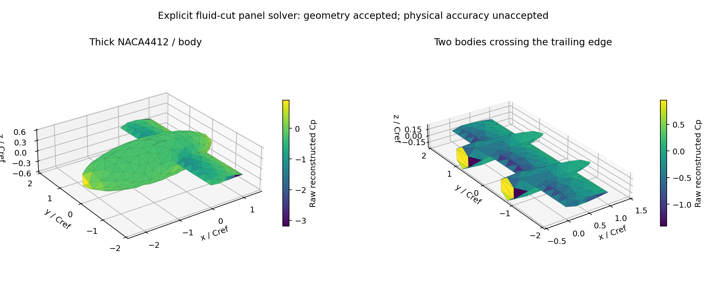

# 厚翼身接触尾迹面元：方法与几何验证

更新：2026-10-25。**本地工作已按用户要求暂停；完整鲁棒求解器尚未整体验收。** 本轮已从前置机身闭环推进到机身跨后缘、粗机身、双机身和真正带接触边界的尾迹。云端协同保持暂停，没有 push、merge 或 GitHub 评论。交接见 [PAUSE_HANDOFF.md](../PAUSE_HANDOFF.md)。

紧凑证据与原始字段哈希见 [summary.json](panel_robustness_evidence_v2/summary.json)。主矩阵37/37项、补充拓扑10/10项通过；四组完整AD/三档中心差分合计180/180个标量比较通过。这些检查认证公开输入范围内的离散实现及几何门禁，**不认证物理精度**。



## 为什么新增一个小求解器

前阶段的 VortexAD 闭环保留，见 [WINGBODY_PANEL_LOOP.md](WINGBODY_PANEL_LOOP.md)。它定位了表面势梯度模板秩亏，但其默认尾迹接口不能直接表达机身遮挡后缘、流体侧带洞尾迹与接触势跳跃的相容约束。本轮没有改造上游接口，而在 `panel/` 独立实现透明的JAX源/偶极子求解器；解析核来自本仓库独立 `core/triangle_kernel.py` 的公式。

`panel/cad.py` 复用旧OCC布尔、部件识别和两遍接触站位构造，只生成二维表面网格，不生成或优化体网格。壁面通过共享边一致绕序、连通组件正体积检查；尾迹仅保留真正邻接流体的曲面。双机身粗例616壁面、细例1646壁面，CAD生成分别为数秒量级。旧P2双机身体网格失败记录不改写。

## 数学约定

壁面外法向，`G=1/(4*pi*r)`，`sigma=-U.n`。本实现的 `mu` 是正的物理扰动势表面迹，与前阶段上游变量的符号约定不可直接混用。

```text
phi' = D_body mu - S sigma + W_linear gamma

[ D_int    W_linear ] [ mu    ] = [ S sigma ]
[ -T       C        ] [ gamma ]   [ 0       ]

D_int 自面内侧迹 = -1/2
C_ij = integral_exposed_TE psi_i psi_j dl
(T mu)_i = integral_exposed_TE psi_i (mu_upper-mu_lower) dl
```

只在真实外露后缘施加**弱势跳跃闭合**，每行除以实际TE支持长度。它不是直接施加或验证尾缘速度相等。每个未知Gamma都必须有真实外露TE支持；机身上不补后缘或Kutta面元。接触曲线的展向投影内，帽函数系数合并为同一个**仍未知的常数**；只有真实翼尖给定零值。

尾迹在固定平面内，Gamma沿x不变、沿y分段线性。每个条带内采用解析一次矩：

```text
M_y = integral_T (y_source-y_centroid) dG/dn
    = (y_target-y_centroid) D + h dS/dy

W_linear = D_constant wake_basis + M_y wake_slope
```

因此没有把线性尾迹偷偷替换成三角形中心常值。7项独立面积Gauss积分/几何导数检查通过；源势、偶极势、一次矩误差分别约6.9e-17、3.1e-16、2.0e-17。原始结果在 `runs/panel_kernel_v1/checks.json`。

表面速度由同一势分支上的无正则切平面最小二乘重构。模板切断真实TE及机身接触切边，仅按几何秩预算从2圈扩到最多6圈，不参考Cp或载荷；变形后再次检查几何条件。原始Cp直接积分翼/身/接缝力和力矩，不裁剪，不使用SVD截断、核半径或配点偏移。

## 构型与工况证据

主批次 `runs/panel_robust_matrix_v1/` 包含14个构型/工况解、3个尺度或参考点变换解、13个预期输入拒绝、4组AD/FD及3个独立场审计。细双机身的额外审计随后保存于同一算例目录，不计入原37项。

| 基准配置，alpha=5度 | 壁面数 | CL | 原始Cp最小值 |
|---|---:|---:|---:|
| 单厚翼 | 484 | 0.241534 | -1.00906 |
| 前置机身 | 696 | 0.269043 | -1.02833 |
| 最大截面在后缘之后 | 694 | 0.257857 | -1.03314 |
| 弯度翼身 | 746 | 0.517686 | -3.17253 |
| 后掠15度、渐缩0.6翼 | 436 | 0.520822 | -4.54874 |
| 半径0.6粗机身与NACA4412 | 824 | 0.527818 | -3.19210 |
| 双机身粗网格 | 616 | 0.263213 | -1.41306 |
| 双机身细网格 | 1646 | 0.312072 | -1.69391 |

另有跨后缘机身alpha=-5/0度、厚度bulge=.4且span=.7、bulge=-.5且span=1.4，粗机身alpha=-8度和双机身alpha=0度。全部原始Cp和载荷有限。JIT后一次前向为0.050～0.427秒，NCPU请求8；该数字不包含编译、CAD和进程启动，也不声称XLA实际线程数被严格限定为8。

同拓扑0.001/1000倍尺度和平移后，Cp最大差分别5.12e-12/3.91e-14；力、力矩分别按尺度平方/立方变换。独立力矩参考点变换误差6.66e-16。基准与变形代表例共180项AD/FD通过，参数为迎角、中心厚度bulge和展长，不包含CAD布尔或重网格导数。

## 输入与尾迹门禁

`solve.py --validate-only` 检查壁面闭合、相反绕序、正体积、实际cut邻接、TE上下配对、条带相容性、Gamma的实际TE支持，以及**从实际接触边图重新推导的**常量约束，不信任摘要字段代替几何。

新增门禁核对有向内部边相消、闭合边界环，并要求每条自由尾迹边属于翼尖或共同下游截断。所有wake面心须在闭体之外；同时求出所有平面壁面与wake平面的交线，逐段检查是否穿过wake三角形开内部，从而检出“面心在外、三角形却跨实体”的情况。归一化平面预算1e-12、重心坐标预算1e-10显式记录，不修改势核或压力。

`runs/panel_topology_matrix_v1/` 的8个公开夹具均接受；一个面心检查会漏掉的小闭体穿过wake的输入被交线门禁拒绝，另一个悬空自由wake边界被分类门禁拒绝。原13项坏输入覆盖开口、重复面、翻面、坏TE配对、漏cut、非平面wake、实体内wake、缺失接触约束、无TE支持的Gamma、退化面和非法参数。

## 保留的物理误差与CAD边界

独立NumPy/Numba审计不导入JAX核，重算真实外场势与速度、解析线性wake梯度和QR重构。表面重构速度按定义在切平面内，不能用它的零法向分量宣称真实无穿透。

| 配置 | 真实面心法向RMS/U | 最大值/U | 重构与外场Cp的RMS差 |
|---|---:|---:|---:|
| 最大截面在后缘之后 | 0.02890 | 3.61692 | 0.18956 |
| 双机身粗网格 | 0.02846 | 0.18013 | 0.23851 |
| 双机身细网格 | 0.04388 | 0.65033 | 0.17524 |

细双机身CL比粗例增大约18.6%，全域法向误差也没有单调下降，**不能宣称网格收敛或物理精度通过**。零迎角残余升力也保留。当前所有结果均为 `physical_accuracy_accepted=false`。

暂停前的4个近相切CAD探针保存在 `runs/panel_cad_limits_v1/`。aft=1.0001成功建表面网格（682壁面，接触展向长度0.00699991），未继续求解；aft=.9999、1.00000001和1.0的首轮失败实际来自OCC保守包围盒超出radius=5，**并非TE或近相切物理条件拒绝**。旧stage标签误导，当前代码已将其更名为 `cad_bounds_pass_*` 并补具体诊断，原失败文件不改写。radius增大后的重试尚未进行。

当前契约限定闭合一致绕序壁面、平面声明TE、条带相容的固定平面wake和固定拓扑变形。未认证任意自交CAD、一般三维旋转、非平面/自由尾迹、重叠接触投影的独立环量、黏性分离或可压缩流。本轮几何优先不等于放弃这些模型边界。

## 复现入口

当前机器求解环境为 `.conda_env/python.exe`；独立审计为 `C:/Users/zyx20/anaconda3/python.exe`。公开JSON夹具无需历史体网格。

```powershell
.\.conda_env\python.exe aero.py --case cases/panel_two_bodies.json --out runs/NEW_TWO --export-surface
.\.conda_env\python.exe aero.py --case cases/panel_cad_wingbody.json --out runs/NEW_CAD --export-surface
.\.conda_env\python.exe panel/verify.py --out runs/NEW_MATRIX --audit-python C:/Users/zyx20/anaconda3/python.exe
.\.conda_env\python.exe panel/verify_topology.py --out runs/NEW_TOPOLOGY
C:/Users/zyx20/anaconda3/python.exe panel/report.py --matrix runs/NEW_MATRIX --topology runs/NEW_TOPOLOGY --out docs/NEW_EVIDENCE
```

`runs/panel_cli_two_final/` 使用补强门禁后的最终求解源码完成入口、45项导数和VTU导出；`runs/panel_cli_cad_v1/` 已完成从CAD到求解及导出。主矩阵保留的是补强交线门禁前的源码快照，新增门禁另有10项验证；不能把不同源码哈希悄悄混作同一个全量批次。所有失败、中间常值wake版本和旧P2产物保留。
