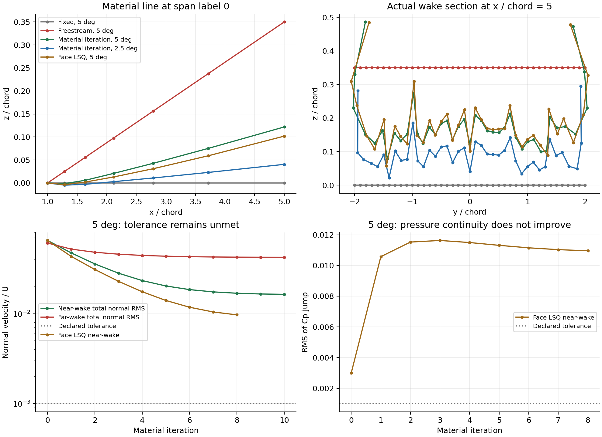

# 尾迹实现与准确性研究

日期：2026-10-26。用户已恢复本地目标，要求在保留几何鲁棒性和可解释性的基础上提升准确性。本节记录的研究**已在 15:00 之后同步到云端**（`local/panel-jax-20261025`，commit `45bf2e6`），并在 issue #25 与 PR #26 回帖；云端协同与 GitHub 监听同日恢复。

## 当前代码与远端状态

- 根目录 `panel/solve.py` 是本轮实际入口；保留了已有的分块核和 checkpoint。
- VJP、Torch 桥、矩阵无关及半模等后续证据主要在隔离 PR 工作副本中。`runs/pr22c_git/` 有半模实现，根目录没有 `panel/matrix_free.py`；不要混用入口。
- 经 `http://192.168.3.9:7890` 只读检查 GitHub，2026-10-26 14:57:52 的末次单次轮询无新事件，开放 PR 15 个。`304` 是 HTTP 未变化响应，不是提交数量。
- 本轮已读 Issue #25 和草稿 PR #26，后者 head 为 `664d9381686d8cfe1070debba8f9a0e327cbdc51`，本地引用 `origin/pr26-research`。主分支仍为 `7b806439e6269c4d419e27fc979318b17f7b6468`，未合并 PR 不代表主分支能力。
- PR26 的同一场重构对照、实际总流尾迹切向残差、有限尾迹控制面和独立细化路线值得继续。本轮没有调用云端执行这些任务。

## VSPAERO 的实际实现

依据本地锁定快照 `upgrade/upstream/OpenVSP-2ddba18ecacb4a2bb0af92705fcfb223d57693b9/src/vsp_aero/Solver/`，不是对最新版 VSPAERO 的泛称。

| 实现 | 文件与行号 | 含义 |
| --- | --- | --- |
| 来流初始化 | `VSP_Solver.C:2595–2631` | 由 alpha/beta 对应的自由来流确定初始尾迹方向 |
| 场与尾迹迭代 | `VSP_Solver.C:3181–3225` | 解场、更新速度/几何、计算力并检查残差，可冻结尾迹 |
| 亚声速尾迹边速度 | `VSP_Solver.C:7578–7689` | interaction list 汇总诱导速度，再加 local freestream；不只是来流方向 |
| 显式稳态更新 | `Vortex_Trail.C:606–708` | 单位局部速度方向乘既定段长；下游节点按 `0.85*WakeRelax` 修正，根部不动 |
| 显式更新约束 | `Vortex_Sheet.C:402–426` | 凹后缘区域或 frozen TE 可以不更新；旋翼另有方向投影 |
| 非定常更新 | `Vortex_Trail.C:862–922` | 速度乘时间步推进 |
| 隐式路径 | `VSP_Solver.C:7707–7778` | Newton 位置修正、段长处理及松弛 |
| 核区处理 | `VSP_Edge.C:3358–3367` | `Fint` 对 `abs(d)<=CoreWidth²` 或 `R<CoreWidth` 返回零，不能称为解析 PV |

速度累加处没有显式跳过目标自边；interaction list 对目标自边是否另有排除尚未完整证明。上述更新路径也没有确认到尾迹穿体后的投影/拒绝/重网格。不能假定 VSPAERO 的自由尾迹直接解决翼身接触问题，也不能把其核区截断不加解释地移植到本项目。

## 本轮实现

`panel/solve.py` 保留 `fixed` 默认值，并新增：

- `freestream`：从真实 TE 倾斜完整无接触尾迹，迎角导数包含处方几何运动。
- `far-freestream`：接触和近尾迹不动，仅原下游延伸段转向来流，铰点必须在全部壁面之后。
- `--wake-offset`：供研究脚本输入归一化三维尾迹位移，壁面/接触节点必须严格零位移。该位移在 AD 中冻结。

全尾迹随来流旋转时拒绝旧接触夹具：原来的 CAD wall/wake 交线不能在旋转后继续充当真实接触线。当前尚未实现倾斜接触切面的重建。

广义线性偶极矩使用每片三角形的物质坐标梯度 `g=grad(eta)`：

```text
M_eta = ((target-centroid) dot g) D + h (grad(S) dot g)
h = (target-centroid) dot n
grad(S) = -sum(outward * edge_log)/(4*pi) - n D
```

初始展向标签随顶点输运，变形后在实际三角形内仿射插值；Gamma 的站位系数保持原物质标签。横向移动和翼尖卷曲后不能用当前位置 y 重新分配环量。核与独立审计均包含一般法向的法向项。

`panel/audit.py` 从实际尾迹计算法向，输出：

1. 两侧距离 `1e-3*sqrt(area)` 与 `5e-4*sqrt(area)` 的平均速度，线性外推到零距离，并保留趋近变化。它是场求值积分近似，不是给物理核加半径，也不移动壁面配点。
2. 总流法向速度、`v_mean dot grad(Gamma)` 和实际两侧 Cp 跳跃，分别检查尾迹运动学、物质环量输运和稳态压力连续性。
3. 速度对势的中心差分检查、物质顶点环量恢复误差。解析核一致不等于离散解满足物理边界条件。

几何检查允许研究物质尾迹的 `n_z` 变号；这可以是连续卷曲，不应一律解释为反转。检查非零面积、wall-plane 横穿、面心绕数和非相邻非共面 wake 三角形的开内部横穿。**尚未认证共面重叠、相切接触、共享顶点/边面片的非局部重合或壁面自交。**

## 同壁面对照

`runs/wake_direction_pairs_20261026/summary.json`：5 个公开夹具，共18次求解；45项实现检查全部通过，包含三个处方尾迹 AD/FD 批次共135个标量比较。独立审计每例确定性抽64片尾迹；不能与全600片的加权 RMS 混为同一个积分。

| 5° 构型 | 改动 | CL 固定 / 改动 | CD压力 固定 / 改动 | 近尾迹总流法向RMS 固定 / 改动 |
| --- | --- | --- | --- | --- |
| 单翼 | 完整来流倾斜 | 0.241534 / 0.241819 | -0.003116 / -0.002975 | 0.04561 / 0.06546 |
| 前置身 | 完整来流倾斜 | 0.269043 / 0.269390 | 0.001702 / 0.002013 | 0.04209 / 0.07095 |
| 跨后缘身 | 仅远段倾斜 | 0.257857 / 0.257887 | 0.000796 / 0.000835 | 0.08411 / 0.08411 |
| 后掠渐缩翼 | 完整来流倾斜 | 0.520822 / 0.522343 | 0.010472 / 0.010703 | 0.08168 / 0.10258 |
| 厚机身 | 仅远段倾斜 | 0.527818 / 0.527978 | 0.009271 / 0.009357 | 0.07914 / 0.07915 |

所有配对壁面逐位相同，零迎角同问题结果一致；五个固定尾迹解对历史 `mu/Gamma/Cp` 最大差 `8.98e-14`。来流倾斜可以使 `U_inf dot n=0`，却未降低上述局部总流残差；不能据此把沿来流倾斜设为“精度修复”。

方向矩阵跨越了几何检查补充的时间点；各解保留各自源文件快照及哈希，不声称全部由一个最终文件哈希产生。

## 局部总流驱动原型

`panel/relax_wake.py`：固定 x，以材料线上的 y/z 为几何未知量。每步重新求解壁面系统，再以独立外场速度更新尾迹，TE固定，x=5后的末段保持来流方向。假设流动 x 单调，反流则拒绝；不是 VSPAERO 的逐段定弧长更新。

- `--update line`：面速度按面积投影到节点，再逐条材料线推进，显式研究对照。
- `--update face-lsq`：不先平均到节点，在固定 `eta` 的仿射面片上最小化 `sum A*|v_x*dX_yz/dx-v_yz|²`。根部及远段约束直接消元，使用满列秩 QR，不截断、不正则。该步冻结当前场速度，仍是 Picard，不是全耦合 Newton。
- 松弛因子默认0.25。几何回退逐次减半并保存每个候选；只调整迭代步，不修改最终物理核/残差。若无合格步则保留失败。
- 收敛须同时满足节点定点残差、近尾迹总流法向RMS和近尾迹压力跳跃RMS。满足这些离散判据也不代表整机物理精度已验收。

线更新原始结果（全600片）：

| 算例 | 次数 | 近尾迹法向RMS 初 / 末 | 壁面法向RMS 初 / 末 | CL 初 / 末 |
| --- | --- | --- | --- | --- |
| 单翼5° | 10 | 0.06549 / 0.01647 | 0.01842 / 0.01844 | 0.241819 / 0.241496 |
| 单翼2.5° | 6 | 0.03561 / 0.01254 | 0.01569 / 0.01570 | 0.123243 / 0.123087 |
| 前置身5° | 6 | 0.06795 / 0.01922 | 0.01973 / 0.01973 | 0.269390 / 0.268660 |

其中单翼5°的追加审计揭示：近尾迹 Cp 跳跃RMS **0.003005 → 0.009412，反而恶化**。线更新不能单靠法向残差下降判为改进。远段法向残差仍显著，单翼压力阻力仍为负；壁面误差没有被解决。全部运行状态保持迭代预算耗尽，物理精度仍为false。

面速度最小二乘对照也已完成：`runs/material_wake_face_lsq_20261026/`，单翼5°共8步，近尾迹法向RMS **0.065491→0.009735**，近尾迹Cp跳跃RMS **0.003005→0.010955**。CL=0.241456，CD压力=-0.003010，壁面法向RMS=0.018438；节点定点最大残差0.08969Cref。QR对角最小/最大比0.148–0.187，全部自由度保留；没有因病态截断。它改善了运动学残差，仍未同步满足动力学条件，不能作为完整自由尾迹交付。

单翼5°最终几何有20片 `n_z<0`；新的横穿检查接受该卷曲。固定该形状重放结果逐位一致，45项冻结形状AD/FD通过，物质顶点环量误差 `1.81e-16`。这不是收敛自由尾迹的全导数。

首轮 `material_wake_single_20261026` 和 `material_wake_single_v2_20261026` 保留正z图面限制触发的失败；v3取消该参数化限制并补横穿检查。不能把首轮失败改写成物理尾迹自交。



## 复现与下一步

```powershell
.\.conda_env\python.exe panel/verify_kernel.py --out runs/NEW_KERNEL
.\.conda_env\python.exe panel/verify_wake.py --out runs/NEW_PAIRS --audit-python C:/Users/zyx20/anaconda3/python.exe
.\.conda_env\python.exe panel/relax_wake.py --surface cases/panel_cut/single_wing.json --out runs/NEW_WAKE --alpha 5 --update face-lsq --iterations 8 --ncpu 8 --audit-python C:/Users/zyx20/anaconda3/python.exe
C:/Users/zyx20/anaconda3/python.exe panel/audit.py runs/NEW_WAKE/iteration_08 --out runs/NEW_AUDIT --wake-samples -1
```

`wake_material_kernel_20261026/checks.json` 的11项核检查通过，任意法向物质矩及速度对48×48面积积分误差小于 `3e-16`。核验证、固定尾迹回归与冻结几何AD各自证明不同实现性质。

下一步联合处理尾迹切向、环量输运/压力连续性残差，先判断受限物质映射和固定物理间距环量条带对卷曲的离散一致性；再以独立的有限远段/截断与沿流细化区分误差。当前两种Picard形状步都只冻结当前场速度，没有实现非线性场/形状耦合Jacobian。随后独立细化壁面和Gamma空间。厚翼身接触推广须重建实际流体切面及接触图，不能旋转旧切面或移动壁面节点。近场压力阻力与理想Gamma-only Trefftz量只作为不同模型诊断。
