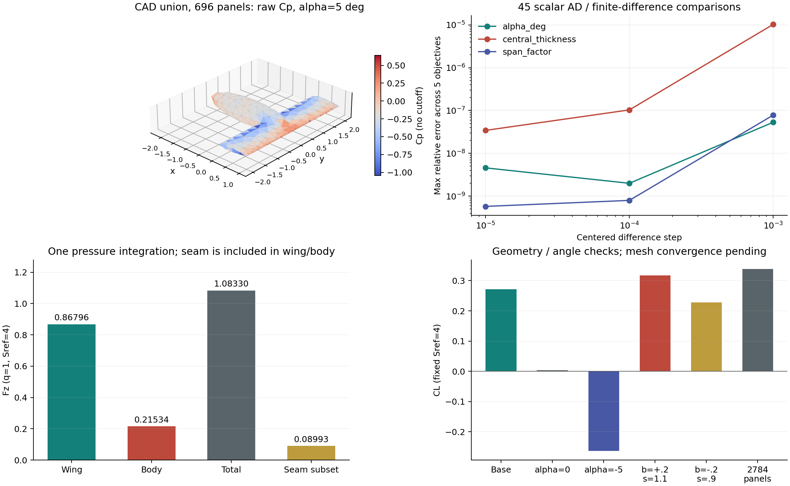

# 第一个厚翼身可微面元验证闭环

更新：2026-10-25。**本阶段闭环已完成；完整通用求解器仍在开发。** 用户已恢复本地工作，云端协同保持暂停。

本阶段从真实公共外表面出发，完成联合势求解、原始压力、机翼/机身/接缝载荷、固定拓扑几何导数、三档中心差分及独立解析场审计。采用锁定的 VortexAD 源/偶极子 Dirichlet 求解器，加本项目显式的表面势梯度重构。没有改动 `aero.py` 默认入口或旧 P2 求解器。

可跟踪的紧凑证据见 [summary.json](wingbody_panel_evidence/summary.json)，包含六个成功算例、各自独立审计、45项导数对照、上游失败对照及原始字段哈希。完整逐面场保留在本地 `runs/wingbody_panel_*/fields.npz`。报告脚本会从这些原始结果重建 JSON 和图。



## 几何与离散

| 项目 | 本次设置 |
|---|---|
| 几何 | NACA0012 厚翼与椭球机身的 CAD 布尔并集 |
| 机翼 | 弦长1，展长4，相对厚度12% |
| 机身 | 中心(-0.7,0,0)，半轴(1.5,0.35,0.35)，末端在机翼后缘之前 |
| 粗网格 | 350节点，696平面三角面元，490翼面、206机身面 |
| 接缝与后缘 | 16条真正共享的翼身接缝边；80条显式上下配对后缘边 |
| 拓扑 | 一个闭合连通外表面，每边恰有两相反绕序相邻面；无埋入面 |
| 尾迹 | 随来流方向的固定平直尾迹，长度30参考弦；不迭代自由尾迹 |
| 参考值 | U=1，rho=2，q=1；固定Sref=4，Cref=1，力矩中心(0.25,0,0) |

夹具位于 `cases/wingbody_panel_forward/surface.json`，SHA256为 `cce9fbfaac214ba7ba9d4c0a7711b31b432b9375826a35413ba2b7588927411a`。直接运行它不需要原CAD或体网格。

提取器只读取已有流体网格的物面，排除远场；用 `original_node` 显式映射合并尾迹两侧重复节点，不按坐标距离猜测焊接。组件标签20为机身、30为机翼。后缘来自已有声明与实际边邻接，不用夹角识别。粗网格最小三角质量0.3271，面积向量闭合误差约4.8e-17。

细夹具 `surface_refined.json` 使用原曲面Tri6的中边节点，每面拆成4个平面三角形，共2784面元。细分面继承父面的绕序；不能分别用父四面体中心判断每个曲面子面的朝向。粗细体积从0.96864变为1.03464，说明这个对照同时改变几何近似和离散分辨率，不能据此估计纯离散收敛阶。

本阶段有意选取机身在后缘前结束的联合体。机身穿过尾迹、后缘遮挡及近相切拓扑不在本次可微面元验证范围；旧 P2 分支的相关成功案例不能直接转移为面元能力。

## 故障定位与修改

本例锁定的上游原始后处理产生25个非有限Cp，但AIC、源强及偶极强度都有限。独立检查显示：切断真实后缘上下邻接后，一圈相邻面中心投影形成的局部二维梯度矩阵有48个数值秩亏面元，均属于机翼。并非每个秩亏模板都必然产生NaN，因此不能只数非有限Cp来诊断。

修复采用两圈面邻接，在每个面元的切平面内拟合同一势迹：

```text
A_i[j,:] = ((c_j-c_i).l_i, (c_j-c_i).m_i)
d_i[j]   = mu_j - mu_i
g_i      = argmin_g ||A_i g - d_i||^2
(ql,qm)  = -g_i
```

只切断显式后缘的上下邻接，保留翼身接缝处的势耦合。每面4至9个邻面；无距离权重、压力裁剪、epsilon、SVD截断或正则化。CSDL计算使用明确的2x2正常方程公式；独立审计用NumPy QR求解同一最小二乘问题。此网格的最小奇异值比为0.09513，两圈模板全部满秩；局部仿射势重现误差7.5e-16，两套梯度最大差2.03e-15。

修复前后的 `AIC_mu/AIC_sigma/mu/sigma` 最大逐项差均为**0**，所以本例的修复没有改变全局离散方程。翼身AIC交叉块范数为0.42697，组件并不是分别计算再拼接。所有载荷只从一份原始Cp逐面积分；接缝是翼/身面元的子集，不能再加到整机力中。

这一诊断针对本次 **VortexAD** 夹具，不证明 OpenVSP 用户所遇到的全部翼身奇异具有相同原因。当前选择是复用可审计的现有求解内核、改造几何契约及后处理，尚无理由立即从零重写整套求解器。

上游保留项也必须明确：Dirichlet配点向内偏置1e-6、核中已有的小量仍存在。本次没有宣称清除了这些处理；新梯度重构本身未增加数值正则化。

## 数值结果

所有成功算例请求NCPU=8，float64，CPU。基准：

| 指标 | 结果 |
|---|---:|
| CL | 0.2716668539 |
| 压力CD | 0.0022061332 |
| CM_y | 0.0318756279 |
| 原始Cp范围 | [-1.0436165, 0.6390994] |
| 机翼Fz | 0.8679569958 |
| 机身Fz | 0.2153444308 |
| 接缝子集Fz | 0.0899324399 |
| 真线性相对残差 | 7.16e-16 |
| AIC的1范数条件数估计 | 361.53 |
| 归一化源通量 | 6.67e-18 |
| 逐面/组件力与力矩闭合最大误差 | 4.44e-16 |
| 编译及首次前向 | 0.829 s |
| 第二次热前向 | 0.100 s |
| 导数编译及首次评价 | 7.81 s |

计时是本机单次记录，非跨机器性能保证；BLAS实际报告8线程，不代表JAX每一步固定占用8个CPU。

| 工况 | 面元数 | CL | Cp最小值 | 独立场法向RMS/U |
|---|---:|---:|---:|---:|
| alpha=5, b=0, s=1 | 696 | 0.271667 | -1.04362 | 0.019716 |
| alpha=0 | 696 | 0.003886 | -0.45126 | 0.017291 |
| alpha=-5 | 696 | -0.263496 | -2.22043 | 0.019859 |
| b=+0.2, s=1.1 | 696 | 0.316916 | -1.13481 | 0.021193 |
| b=-0.2, s=0.9 | 696 | 0.228471 | -0.95187 | 0.018440 |
| alpha=5，Tri6细分 | 2784 | 0.338250 | -1.50827 | 0.017391 |

六例全部得到有限原始字段，载荷闭合误差均小于3.2e-15。零迎角残余升力与正负迎角的不完全对称保留；当前非对称表面三角剖分没有提供严格镜像离散。

细分后CL变化24.5%，法向最大误差从0.2127增至0.3016。因此本轮确认的是所列构型的几何/数值可运行性，尚无网格独立性或绝对精度结论。

## 可微链路

三个连续输入直接移动公共顶点，并重新计算几何、AIC、尾迹、势、压力及载荷：

```text
alpha_deg = alpha
y' = s*y
z' = z*(1 + b*exp(-(y/(0.5*Cref))^2))
x' = x
```

这里b改变中央区域的翼和机身厚度，不是只改变机身的独立参数；Sref固定不随展长变化。CAD布尔、重新剖分和拓扑转换不参与求导。CSR邻面收集是固定线性映射，保留对全部连续几何量的梯度。

五个标量目标为CL、机翼Fz、机身Fz、接缝Fz、CM_y。每个输入用h=1e-3、1e-4、1e-5中心差分，**45/45项通过** `abs(AD-FD) <= 2e-7 + 2e-4*abs(AD)`。h=1e-4时最大相对差1.03e-7。

| 输入 | dCL | d翼Fz | d机身Fz | d接缝Fz | dCM_y |
|---|---:|---:|---:|---:|---:|
| alpha_deg | 0.0530350 | 0.170625 | 0.0421768 | 0.0170810 | 0.00632190 |
| b | 0.0116547 | 0.0521241 | -0.00614985 | 0.0106519 | 0.00559732 |
| s | 0.420112 | 1.33660 | 0.340342 | 0.125358 | 0.0599721 |

这些是当前离散模型的导数一致性验证，不是气动力导数的物理精度验证。

## 独立物理审计

`audit_wingbody_panel_loop.py` 使用已有 `core/triangle_kernel.py` 的NumPy/Numba解析场核，与构造Cp的CSDL梯度路径分开。VortexAD的mu为负的表面扰动势迹，本审计采用：

```text
sigma = -U.n
phi' = -D_body*mu - S*sigma - D_wake*mu_wake
V = U - grad(S)*sigma - grad(D_body)*mu - grad(D_wake)*mu_wake
mu_wake = mu_upper - mu_lower
```

尾迹三角绕序与势跳跃逐项检查。后一个等式验证跳跃匹配，不单独等同于完整物理Kutta验收。

真实面心外侧迹的法向RMS为0.019716、最大值0.212742；接缝RMS为0.023602。独立内侧Dirichlet势RMS为6.25e-6；直接场Cp与表面重构Cp的面积加权RMS差为0.19650。

外侧距离从 `1e-2*sqrt(area)` 减至 `1e-4*sqrt(area)` 时，场速度与解析外迹的RMS差从2.72e-3降至2.73e-5，支持外侧迹符号与趋近实现的一致性。力矩参考点移动检查误差4.44e-16。

`Qn=U.n+sigma` 在此Dirichlet表面恢复路径中恒为零，**不作为真实无穿透证据**。独立场未通过既有严格面心门限，故所有结果仍记录 `physical_accuracy_accepted=false`。没有为了完成本阶段而放宽旧门限。

## 从干净源码复现

在仓库根目录运行。参考前向环境为Python3.11.17，具体直接依赖版本在 `test/wingbody_panel_requirements.txt`。CSDL-alpha也固定源码提交，不依赖PyPI同名版本：

```powershell
python -m venv .venv-wingbody
& .\.venv-wingbody\Scripts\python.exe -m pip install -r test/wingbody_panel_requirements.txt
git -c http.proxy=http://192.168.3.9:7890 clone https://github.com/LSDOlab/CSDL_alpha.git .tmp/csdl-wingbody
git -C .tmp/csdl-wingbody checkout --detach d4bf50ec91e722673b31849c4dfdad4c3076c715
& .\.venv-wingbody\Scripts\python.exe -m pip install .tmp/csdl-wingbody
git -c http.proxy=http://192.168.3.9:7890 clone https://github.com/LSDOlab/VortexAD.git .tmp/vortexad-wingbody
git -C .tmp/vortexad-wingbody checkout --detach ab6493981d5ff19721ba9fc42b6d015310d3d5cd
& .\.venv-wingbody\Scripts\python.exe test/patch_vortexad_raw_cp.py --backend .tmp/vortexad-wingbody
& .\.venv-wingbody\Scripts\python.exe test/run_wingbody_panel_loop.py --surface cases/wingbody_panel_forward/surface.json --backend .tmp/vortexad-wingbody --out runs/my_wingbody_loop --ncpu 8
```

VortexAD通过显式源码路径导入；补丁只开放 `Cp_raw` 和 `cutoff=None`，与现有原始Cp补丁一致。已经用一个干净的本地源码克隆实际验证补丁及完整45项导数流程，而不是只在已修改checkout上运行。

独立审计可使用另外的NumPy/SciPy/Numba环境。实测为Anaconda Python3.13.9，NumPy2.3.5，SciPy1.16.3，Numba0.62.1，threadpoolctl3.5.0；不要求此环境安装JAX：

```powershell
& C:\Users\zyx20\anaconda3\python.exe test/audit_wingbody_panel_loop.py runs/my_wingbody_loop --ncpu 8
```

原始故障也有明确入口。以下命令**预期非零退出**，保留 `fields.npz` 与 `failure.json`，应得到25个非有限Cp：

```powershell
& .\.venv-wingbody\Scripts\python.exe test/run_wingbody_panel_loop.py --surface cases/wingbody_panel_forward/surface.json --backend .tmp/vortexad-wingbody --out runs/my_wingbody_upstream --forward-only --upstream-pressure
```

补充工况分别传 `--alpha 0`、`--alpha -5`、`--bulge 0.2 --span 1.1`、`--bulge -0.2 --span 0.9` 并加 `--forward-only`；细网格改为 `--surface cases/wingbody_panel_forward/surface_refined.json`。所有输出目录使用新名字，避免覆盖失败证据。

报告中的六个本机目录分别为 `wingbody_panel_final`、`wingbody_panel_alpha0`、`wingbody_panel_alpha_minus5`、`wingbody_panel_thick_wide`、`wingbody_panel_thin_narrow`、`wingbody_panel_refined`，原始失败为 `wingbody_panel_upstream`，均在 `runs/` 下。每例运行独立审计后：

```powershell
& C:\Users\zyx20\anaconda3\python.exe test/report_wingbody_panel_loop.py
```

每次求解保存运行脚本快照、夹具副本、环境、源码哈希和原始逐面字段；最终基准额外保存实际后端commit、全部后端Python源文件哈希及CSDL源树哈希。旧v1-v7失败/中间记录均保留。

## 后续推进

下一阶段保持几何鲁棒性优先：在同一求解与载荷链上接入机身跨后缘的外露后缘分段、尾迹与机身相交的拓扑契约，再做独立构型矩阵。随后评估是否将两圈重构移入正式后端，并用局部满秩条件选择模板；不先用隐藏稳定项强行给出有限结果。

绝对精度工作保留为独立任务：区分曲面几何变化、常面元离散误差和表面梯度误差，继续记录真实外场无穿透与Kutta证据。低速可微面元是当前闭环路线；现有全势/P2代码继续作为独立对照与可压缩研究路径。
