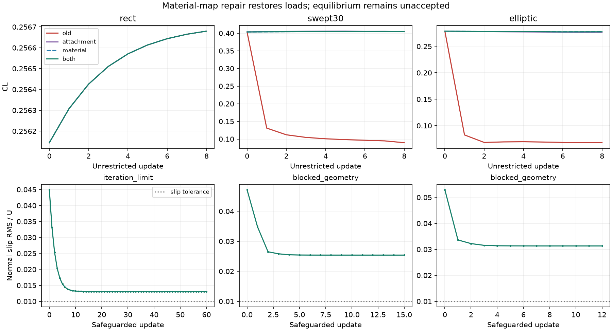

# Local B3 material-map repair and performance checks

Date: 2026-11-05. Based on PR #114 `febedcca`, then local repairs.
Windows 11 / myml Python 3.13.14 / NumPy 2.4.6 / Torch 2.13.0+cu132 /
RTX 5060. BLAS, OMP and MKL use one thread. No cloud coordination.

**Software regressions are repaired; free-wake physical equilibrium is not
accepted.** The solver can now stop explicitly with `blocked_geometry`.
Do not interpret preserved loads or small accepted steps as convergence.

## Root cause and change

The old map integrated along arbitrary mesh predecessor edges, discarded each
edge's reference transverse offset, and fixed only graph roots. Thus even
uniform axial flow moved swept/elliptic TE attachments and collapsed flat
reference triangles. This is a kinematic defect, independent of OpenBLAS.
PR #114 added attachment metadata and offsets but had a 3D/2D broadcasting
error, a required-field compatibility regression and a wrong rectangular
fixture assertion.

The local map integrates P1 nodal velocity slopes along constant reference-y
lines through the actual reference triangles. Sparse weights integrate each
piece exactly; intervals on shared edges are counted once. A disconnected
upstream interval is not used for a node in another interval. Declared TE
attachments are pinned through raw target, relaxation and step limiting.
Manufactured tests use independent affine-flow formulas, not predecessor
recurrences, including irregular node positions and a nonplanar extruded TE.
Runtime sparse accumulation uses NumPy without a SciPy import or dense matrix.

Conservative orientation backtracking rejects reference-normal projection
reversals. It is not a complete collision test and can restrict physical
large-angle roll-up. Convergence additionally requires the raw map residual,
normal slip and frozen-node criteria; a clipped or tiny step cannot establish
equilibrium. G2 T5's separate material update was not replaced.

## Numerical Results

All four modes start with identical frozen wall/material arrays, alpha 4 deg,
pressure-Kutta, Gamma DOFs, probes and nominal relaxation 0.3. The four-way
8-step ablation disables the new backtracking to isolate map changes.

| Case | Initial CL | Old CL at 8 | Attachment-only CL at 8 | Combined CL at 8 | Old / combined self-intersection pairs at 8 |
| --- | ---: | ---: | ---: | ---: | ---: |
| Rect | 0.256144 | 0.256680 | 0.256680 | 0.256680 | 0 / 0 |
| Swept30 | 0.403536 | 0.089600 | 0.404464 | 0.404564 | 334 / 8 |
| Elliptic | 0.278757 | 0.067846 | 0.276617 | 0.277455 | 528 / 124 |

Material-only equals combined on these meshes: the correct material-ray
boundary already gives TE nodes zero integration length. Explicit attachment
metadata remains necessary for topology validation and final pinning.
The load collapse is repaired, but unrestricted geometries remain invalid.

The final source was then run with a 60-update budget and backtracking:

| Case | Actual updates | Stop | Final CL | Raw map residual / c | Normal slip / U |
| --- | ---: | --- | ---: | ---: | ---: |
| Rect | 60 | iteration_limit | 0.256715 | 4.84e-10 | 0.013017 |
| Swept30 | 15 | blocked_geometry | 0.404155 | 1.09296 | 0.025402 |
| Elliptic | 12 | blocked_geometry | 0.278324 | 1.66144 | 0.031309 |

Declared TE and actual wall-contact displacement are exactly zero in all
three final runs. Audited checkpoints (0, 1, 8 and terminal state) have no new
wall violations or wake self-intersections. This is an endpoint audit, not a
swept-motion proof for every intermediate trial. All recorded original inner
criteria pass; Swept30 fails the stricter 1.05 wall-floor ratio at all 16
states. The normal-slip tolerance is 0.01; none of the three reaches it.

The controlling far-wake faces span x about 5c to 31c, with a tip width about
0.025c for Elliptic. Tail-only midpoint refinement preserves the finite
boundary, Gamma DOFs and initial P1 potential space; initial CL changes by
less than 8e-13. However, 3811 and 10553 wake faces give final 8-step normal
slip 1.2077 and 2.7008, respectively, versus about 0.07 on the original
combined mesh. They do not fix equilibrium. Area-scaled probes also move
when faces are subdivided, so this is not an independent mesh-convergence
test. No automatic remeshing or probe/default change was adopted.



## Same-Model Performance

`tools.wake_velocity_benchmark` reads the tracked frozen `initial_state.npz`;
it freezes mu, Gamma, geometry, sources and targets. B3 uses identical
doublet potentials and identical two-sided finite differences in both
backends. The Torch option reuses the existing
`p1_batched_influence.source_invariants/block_rows` kernel and includes
source preparation and transfers in timing.

The preliminary 504-target Swept30 check (`velocity_benchmark.json`) measured
NumPy/24 at 0.60648 s and Torch/CUDA/512 at 0.03327 s (18.23x); maximum
finite-difference velocity difference is 2.97e-13. CPU batching did not help.
The separate analytic-velocity comparison measured 18.85x CUDA speedup and
2.40e-14 maximum velocity difference against the same analytic loop.
These two timing families must not be compared across formulas. Initial
measurements shared the host with other work; the master checkout rerun
is recorded separately in `master_velocity_benchmark.json`.

An actual unrestricted 8-step Swept30 CPU/GPU comparison has maximum CL
difference 2.79e-14. Its wall times include audits and concurrent host work;
they are not an isolated whole-solver speedup measurement. NumPy remains
the default. CUDA acceleration is opt-in:

```powershell
python -m panel.run_p1_steady_wake --out <fresh-output> --wake-potential-backend torch --wake-device cuda --wake-velocity-block 512
```

## Reproduction

Use `C:/Users/zyx20/anaconda3/envs/myml/python.exe` and set
`OPENBLAS_NUM_THREADS=1 OMP_NUM_THREADS=1 MKL_NUM_THREADS=1`.

```text
python -m pytest -q test -p no:cacheprovider
python -m tools.wake_material_suite --out <fresh-runs> --workers 3
python -m tools.wake_material_collect --runs <fresh-runs> --out <fresh-receipt.json>
python -m tools.wake_material_ablation --case elliptic --mode both --iterations 8 --unguarded --potential-backend torch --device cuda --block 512 --refine-tail-levels 4 --out <fresh-run>
python -m tools.wake_velocity_benchmark --case swept30 --out <fresh-benchmark.json>
```

Final full suite: **11 failed, 825 passed, 21 skipped**, 226.52 s; all failure
IDs exactly match `runs/verification/native_blas/fixed_pytest.log`. Latest
coupled-material/manufactured tests: **62 passed**, 29.70 s. Sparse/guards/
LAPACK-contract checks: **35 passed**. CLI/docs checks: **16 passed**.
A real CUDA CLI two-update run completed and reported `iteration_limit`.

History JSONs are retained once under
`runs/studies/wake_material_repair/{suite,final,tail_refinement,parity_swept_cpu,parity_swept_gpu}`.
Large per-state NPZ snapshots remain local; regenerate them with the commands
before rerunning independent collision audits on another clone. Checkpoint
snapshot hashes, actual commands and source hashes are recorded. Revisions
started from dirty development sources retain source hashes; final main
checks use core commit `0ea2ab8`.

## Preserved Failures

- `first_step.json` and `first_step_material_rays.json` preserve development
  failures handling nearly horizontal CAD edges and disconnected TE ray
  intervals. They are not the final three-case result.
- `raw8_geometry.json` is an invalid early self-audit: the generic coplanar
  hull routine rounds to 12 decimals and reports tiny positive overlap for
  adjacent flat faces. **Do not use its intersection counts.**
  `raw8_geometry_checked.json` uses unrounded projected triangle clipping and
  separates roundoff-scale area. `final_geometry.json` also records independent
  adjacent/identical/segment controls. Coplanar areas below
  `64 * machine_epsilon * pair_span^2` are unresolved roundoff, reported
  separately; this does not change the production wall-contact tolerance.
- `full_pytest.log` preserves the initial 12-failure run, whose extra failure
  was the live-path SciPy-import contract. The sparse NumPy replacement fixes
  it; use `full_pytest_final.log` for the final failure set.

No issue was closed, no cloud message was sent, and physical acceptance
remains false. Free-wake shape derivatives were not established by this work.
